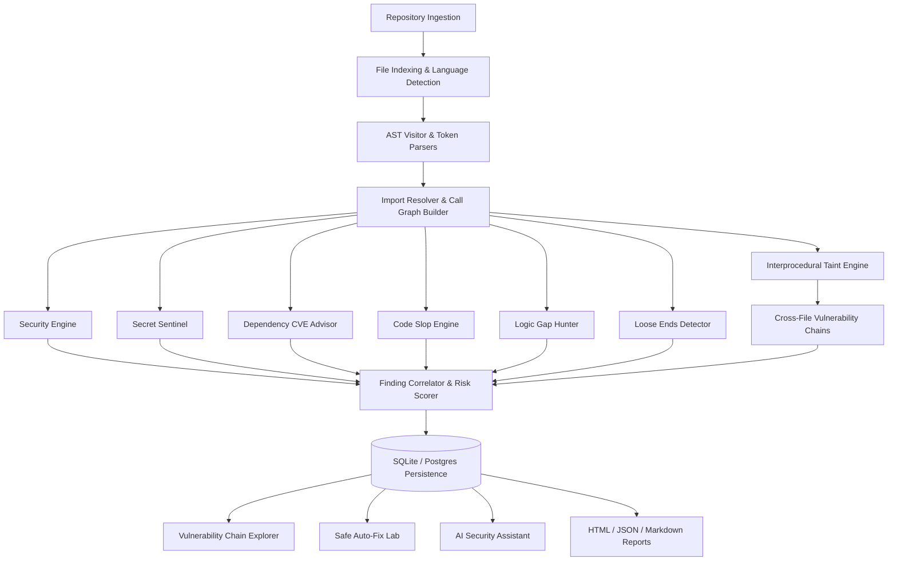

# CodeSentinel AI
> **Understand Your Code. Discover Hidden Risks. Fix With Confidence.**

Autonomous Security Intelligence, Cross-File Vulnerability Detection & Software Engineering Audit Platform.

Built for the **Mycrobo 24-Hour Hackathon — SRM University-AP**.

---

## 1. Platform Overview

Traditional static application security testing (SAST) tools generate isolated, noisy line alerts. Conversely, standard code-review chatbots frequently suggest fixes without proving that dangerous data can actually reach a vulnerable operation.

**CodeSentinel AI** bridges this divide by performing deep interprocedural analysis:
```
UNDERSTAND ➔ INVESTIGATE ➔ DETECT ➔ CORRELATE ➔ EXPLAIN ➔ REMEDIATE ➔ VERIFY ➔ REPORT
```

### Core Capabilities:
1. **Flagship Cross-File Vulnerability Chains:** Dedicated static taint analysis engine that traces untrusted user inputs from entry points across intermediate controllers and helper modules into dangerous sinks (such as raw SQL queries, file operations, and OS execution).
2. **Code Slop Intelligence:** Objective 0–100 scoring quantifying technical debt, duplicate blocks, unused imports, dead functions, and deep nesting with transparent deductions.
3. **Coding Gap & Edge-Case Hunter:** Proactively detects unhandled nulls, missing boundary checks, missing authentication, and unhandled I/O exceptions with triggering scenarios.
4. **Loose Ends Tracker:** Scans for unresolved `TODO`, `FIXME`, `HACK`, placeholder stubs (`pass`), and `NotImplementedError` runtime traps.
5. **Safe Auto-Fix Remediation Lab:** Generates targeted unified diff patches, enforces explicit user approval, creates automatic file backups, and runs static re-verification to confirm resolution.
6. **Provider-Agnostic Intelligence:** Seamlessly runs 100% locally with high-precision deterministic rules with no external API keys required. Optionally integrates with Ollama or OpenAI-compatible endpoints.

---

## 2. Architecture & Data Flow



---

## 3. Flagship Demonstration Flow

The repository includes a multi-tier Python project (`sample-projects/vulnerable-python`):
- `frontend/login.js`: Client submits search query.
- `backend/routes.py`: Controller accepts parameter `q` without validation.
- `backend/services.py`: Intermediate service forwards parameter to database layer.
- `backend/database.py`: Dangerous sink executes raw SQL query with unescaped f-string interpolation (`cursor.execute(f"SELECT ... {search_term}")`).
- `backend/config.py`: Hardcoded AWS credentials and JWT secret key.
- `utils/helpers.py`: Unimplemented stubs, duplicate blocks, and loose ends.

### In CodeSentinel AI:
1. Click **Try Demo Project** on the Landing Page or Navbar.
2. The 17-stage static analysis engine extracts the cross-file call graph.
3. Open **Vulnerability Chain Explorer** to see the interactive data-flow graph from `routes.py:11` ➔ `services.py:18` ➔ `database.py:25`.
4. Open the **Safe Auto-Fix Lab**, inspect the parameterized SQL patch diff, approve the patch, and run the automated verification scanner to confirm the vulnerability is eliminated.

---

## 4. Quickstart Guide

### Prerequisites
- Python 3.10+
- Node.js 18+ & npm

### Windows (One-Click)
Double-click or run:
```cmd
run-dev.bat
```

### Manual Setup

#### 1. Backend:
```bash
# In project root
python -m venv backend/venv
# Windows
.\backend\venv\Scripts\activate
# Linux/macOS
source backend/venv/bin/activate

python -m pip install --require-hashes -r backend/requirements.lock
# Configure a random API_ACCESS_TOKEN (at least 32 characters) in the process environment or .env.
# For local HTTP development only, set AUTH_COOKIE_SECURE=false.
python -m uvicorn backend.app.main:app --reload --port 8000
```
Backend API will be running at `http://127.0.0.1:8000` (Interactive Swagger docs at `http://127.0.0.1:8000/api/docs`).
The website opens without an access-pin prompt. API authentication is disabled by default (`API_AUTH_ENABLED=false`) for local development. To protect the API when exposing it beyond your local machine, set `API_AUTH_ENABLED=true`, configure a random `API_ACCESS_TOKEN` of at least 32 characters, and use HTTPS with `AUTH_COOKIE_SECURE=true`. The optional token gate protects API routes; it is one shared identity, not per-user tenant isolation.

#### 2. Frontend:
```bash
cd frontend
npm install
npm run dev
```
Frontend interface will be running at `http://localhost:5173`.

Generate a token without adding it to source control:
```powershell
python -c "import secrets; print(secrets.token_urlsafe(32))"
```
For protected deployments, set the generated value as `API_ACCESS_TOKEN` and `API_AUTH_ENABLED=true` in the backend environment or `.env`. An unset or short token fails closed: protected API routes return HTTP 503.

---

## 5. Automated Test Suite

Run the backend tests and frontend checks from the repository root:

```bash
.\backend\venv\Scripts\python.exe -m pytest backend/tests -v
cd frontend
npm ci
npm test
npm run build
```

`backend/requirements.txt` pins the direct Python dependencies; `backend/requirements.lock` pins the complete resolved graph with hashes for reproducible installs. Regenerate it after intentionally updating direct pins with `pip-compile --generate-hashes --output-file backend/requirements.lock backend/requirements.txt`.

The backend tests cover API workflows, project ingestion, analysis, taint propagation, remediation, authentication, and reporting. Frontend tests exercise route matching; the production build runs the TypeScript compiler before producing the Vite bundle. Test results are environment-dependent; do not treat a successful build as evidence that every analysis capability is complete.

Cross-file taint propagation is Python-focused. Supported evidence includes route-parameter sources, statically connected function calls with positional or named arguments, local aliases, tuple bindings, loop targets, and selected conditional assignments. A direct `shlex.quote(...)` use is recognized for command analysis; SQL/path sanitizer inference is not generalized. Conditional flow joins can retain taint after safe overwrites and produce false positives. Source/sink and call-graph matching are syntax-driven and can miss dynamic dispatch, complex control flow, wrappers, and unsupported expressions. JavaScript/TypeScript parsing is structural and does not provide cross-file taint guarantees. Confidence values are fixed heuristics, not probabilities. Results are static-analysis evidence, not formal verification.

Dependency findings come from a small built-in advisory catalog and conservative version-constraint checks. This is not a live OSV feed, lockfile resolver, or complete dependency audit; confirm findings and resolved versions with a current package-audit tool.

---

## 6. Project Layout

```text
codesentinel-ai/
├── backend/
│   ├── app/
│   │   ├── agents/         # AI service & rule-based assistant
│   │   ├── analyzers/      # AST visitor, call graph, taint engine, slop & logic gap hunters
│   │   ├── api/            # FastAPI REST endpoints
│   │   ├── core/           # Config, database, security limits
│   │   ├── correlation/    # Finding correlator & scoring algorithms
│   │   ├── models/         # SQLAlchemy database models
│   │   ├── remediation/    # Safe auto-fix patch engine & verifier
│   │   ├── reports/        # Standalone HTML, JSON, Markdown generators
│   │   ├── scanners/       # AST security rules, Gitleaks secrets, CVE dependency advisor
│   │   ├── schemas/        # Pydantic input/output schemas
│   │   ├── services/       # Project ingestion & 17-stage audit pipeline
│   │   └── main.py         # Application entry point
│   ├── tests/              # Pytest automated test suite
│   └── requirements.txt
├── frontend/
│   ├── src/
│   │   ├── components/     # Monaco code viewer, diff viewer, chain visualizers
│   │   ├── pages/          # Dashboard, Chains, Findings, Quality, Gaps, Remediation, Reports
│   │   ├── services/       # Typed API client
│   │   └── types/          # TypeScript domain interfaces
│   ├── package.json
│   └── vite.config.ts
├── sample-projects/        # Real multi-tier vulnerable testbeds
│   ├── vulnerable-python/  # Multi-file SQL injection, secrets, slop
│   └── sample-javascript/  # Node.js path traversal & loose ends
├── docs/                   # Architecture, security model, and scoring methodology
├── Dockerfile              # Production container build
├── docker-compose.yml      # Multi-container orchestration
├── run-dev.bat             # One-click Windows launch script
└── run-dev.sh              # One-click Linux launch script
```

---

## 7. Security & Ethics Disclaimer

CodeSentinel AI performs static analysis without executing untrusted code on the host. All sample credentials contained within `sample-projects/` are synthetic, non-functional test tokens used solely for vulnerability detection demonstration.
