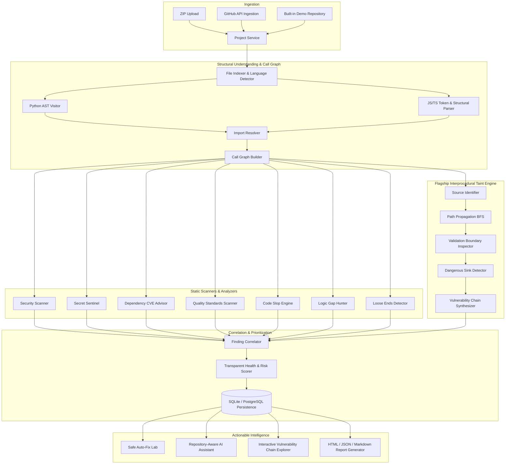
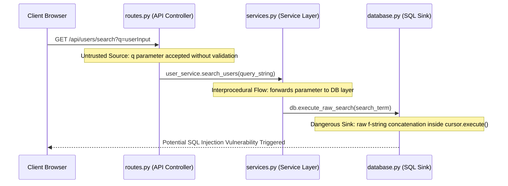

# CodeSentinel AI — System Architecture & Design Specification

## 1. Executive Architectural Overview

CodeSentinel AI is a static cybersecurity and software engineering audit platform. It models available codebase relationships, correlates supported Python interprocedural taint flows, uncovers selected boundary conditions, and can verify remediation with a targeted static re-scan.

---

## 2. Core Architectural Subsystems

### 2.1 Repository Ingestion & Workspace Isolation
- **Zip Extraction Protection:** Protects against Zip-Slip path traversal using canonical boundary checks `os.path.realpath(target).startswith(realpath(root))`.
- **Zip-Bomb Limits:** Enforces a maximum extracted payload size (50MB) and file counts (5000 files).
- **Zero Host Execution:** Uploaded files are strictly parsed via static AST and regex lexers; no untrusted code is executed during analysis.

### 2.2 Structural Understanding & Interprocedural Call Graph
1. **Python AST Visitor (`ast.NodeVisitor`):**
   - Extracts top-level and nested classes, methods, decorators, and function signatures.
   - Extracts import statements (`import foo`, `from bar import baz`).
   - Extracts assignments and variable bindings to track object instances (e.g. `user_service = UserService()`).
   - Extracts function calls, caller objects, and arguments.
2. **Import Resolver (`ImportResolver`):**
   - Resolves relative imports (`.services`), absolute root packages (`backend.services`), and sub-modules.
3. **Call Graph Builder (`CallGraphBuilder`):**
   - Links caller functions to callee functions across multiple source files.
   - Categorizes edges as `statically_verified` (direct match via resolved imports) or `inferred` (heuristic single unique name match).

### 2.3 Flagship Cross-File Vulnerability Chain Engine (`TaintEngine`)
The flagship differentiator traces how user-controlled input travels from web entry points across application layers to reach critical sinks.

### 2.4 Code Slop Intelligence Engine
Computes a transparent Code Slop score from 0–100 using documented deductions:
- Duplicate logic blocks across files (-12.5 pts each)
- Dead / uncalled functions (-10 pts each)
- Unused imports (-5 pts each)
- Excessive cyclomatic complexity and deep nesting (-5 pts each)

### 2.5 Safe Auto-Fix Remediation Lab
1. **Targeted Patch Synthesis:** Generates evidence-backed syntax replacements (e.g. replacing string concatenation in SQL queries with parameterized `?` placeholders).
2. **Unified Diff Computation:** Generates unified diffs using Python's `difflib`.
3. **Explicit User Approval:** Requires affirmative user consent before modifying files.
4. **Isolated Application & Backup:** Writes changes and creates `.codesentinel_backup`.
5. **Static Verification:** Re-runs the security scanner against the modified file to verify the finding is resolved.
6. **Rollback:** Instant restoration from `.codesentinel_backup` if needed.

---

## 3. Technology Stack

- **Frontend:** React 18, TypeScript, Vite, Tailwind CSS, Lucide React, Monaco Editor (`@monaco-editor/react`).
- **Backend:** Python 3.10+, FastAPI, Pydantic v2, SQLAlchemy, SQLite (production ready for PostgreSQL).
- **Security & Linters:** AST engine, Gitleaks-pattern secret scanner, limited built-in dependency advisory catalog, and optional Semgrep & Bandit CLI integration.
- **Reporting:** Standalone responsive HTML reports, JSON findings, GitHub Markdown summaries.
